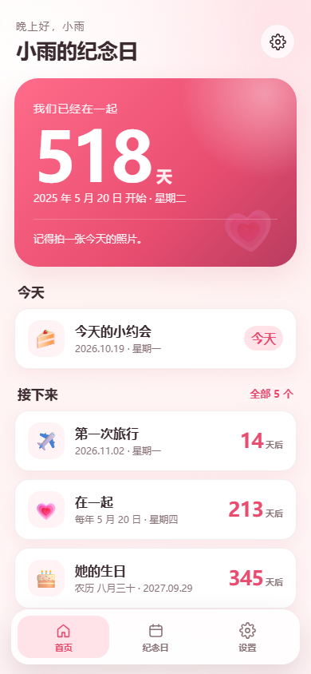
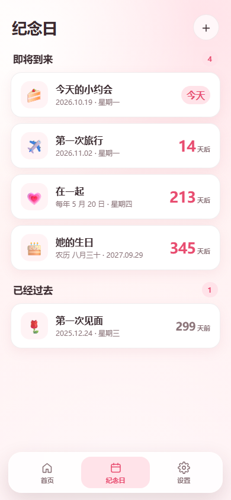
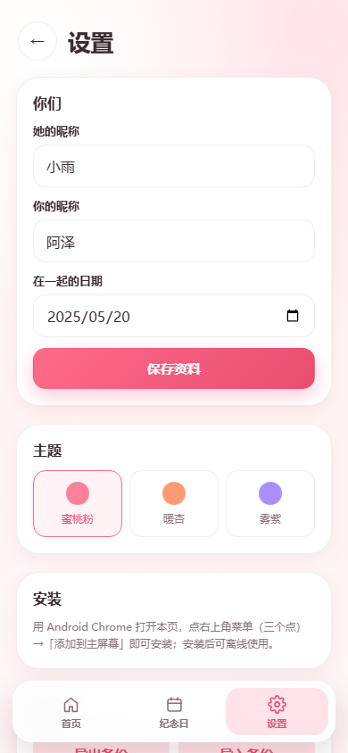

# 我们的纪念日

一个给女朋友的纪念日 PWA：在一起多少天、生日和纪念日倒计时，公历和农历都支持。

- **Android 优先**：用 Chrome 打开后「添加到主屏幕」，像普通 App 一样从桌面打开。
- **完全离线**：数据只存在她手机浏览器的 `localStorage` 里，没有后端、不上传。
- **无构建依赖**：原生 HTML/CSS/ES Module，不需要 npm install。

| 首页 | 纪念日 | 设置 |
| --- | --- | --- |
|  |  |  |

## 功能

- 在一起第 N 天（起始当天算第 1 天），跨零点自动更新。
- 纪念日增删改：公历每年重复、农历每年重复、一次性日期。
- 公历 / 农历生日倒计时；农历支持 1900–2100 年。
- 今天有纪念日时首页高亮显示。
- 三套暖色主题、自定义昵称、emoji 图标。
- 导出 / 导入 JSON 备份，清空数据前二次确认。
- 离线可用；有新版本时提示刷新。
- 预留同步接口（`assets/sync.js`），v1 不联网。

## 部署到 GitHub Pages（推荐路径）

> 这台电脑当前没有安装 Git，所以用 GitHub 网页上传即可；`deploy/love-days/` 已经是一个可直接上传的站点目录，压缩包是 `love-days-github-pages.zip`。

1. 登录 GitHub，新建仓库：名字建议 `love-days`，可见性选 **Public**（免费版 Pages 需要公开仓库），不要勾选初始化 README。
2. 在仓库页点 **Add file → Upload files**，把 `deploy/love-days/` 里面的**所有内容**拖进去（保留 `assets/`、`icons/` 目录结构），提交。
3. 进入 **Settings → Pages**：
   - Source 选 **Deploy from a branch**
   - Branch 选 **main**，目录选 **/ (root)**
   - 点 **Save**
4. 等 1–2 分钟，访问：

   ```text
   https://<你的 GitHub 用户名>.github.io/love-days/
   ```

5. 手机 Chrome 打开这个地址 → 右上角菜单（三个点）→ **添加到主屏幕**。之后从桌面图标打开，断网也能用。

### 有 Git 的话

```bash
git init
git add .
git commit -m "love days pwa"
git branch -M main
git remote add origin https://github.com/<你的用户名>/love-days.git
git push -u origin main
```

然后在仓库 Settings → Pages 里选择 `main` + `/(root)`。

### 更新版本

改完文件重新上传后，把 `sw.js` 第一行的 `VERSION` 改一下（例如 `v1.0.1`），她下次打开会看到「有新版本啦」，点刷新即可。没有改 `VERSION` 时，静态资源也会在后台尝试更新，但可能要多打开一次。

### 访问不了 GitHub Pages？

国内网络访问 `*.github.io` 可能不稳定。整套文件可以直接搬到 Cloudflare Pages / Vercel（同样免费、支持 HTTPS），代码不需要改。

## 数据、隐私与备份

- 存储键：`love-days.v1`；换域名/换浏览器都不会自动带过去。
- 数据只在她的手机里，应用不发起任何数据上传请求。
- **清理浏览器数据、卸载浏览器或换手机都会丢数据**。设置页有「导出备份」，建议偶尔导一份存到网盘/电脑。
- 导入会覆盖当前数据，导入前会显示条数并二次确认。
- 本地数据损坏时，原始内容会备份到 `love-days.v1.corrupt.<时间戳>`，应用会提示而不是静默清空。

## 日期与农历规则

- 所有计算按手机本地日历日；天数差用 UTC 归一化，不受夏令时影响。
- 起始日期在未来时，首页显示「距离开始还有 N 天」。
- 每年重复的公历纪念日：2 月 29 日在平年按 **2 月 28 日**。
- 农历纪念日：小月没有「三十」时按当月最后一天（廿九）算。
- 闰月生日 v1 统一按**普通月份**处理（设置/编辑页有说明）。
- 农历日期超出 1900–2100 会拒绝保存。

## 本地开发

需要 Node.js 18+（可选 Python 3）：

```bash
# 本地预览（无需安装依赖）
npm run serve
# 打开 http://127.0.0.1:5173/

# 或者
python -m http.server 5173 --bind 127.0.0.1
```

```bash
# 单元测试：日期、农历、存储、排序
npm test
```

> 测试用单进程运行（`tests/run.mjs`），避免 `node --test` 在受限环境里 spawn 子进程。

### 文件结构

```text
index.html                 页面骨架
manifest.webmanifest       PWA 清单（安装到主屏）
sw.js                      Service Worker：离线缓存 + 版本更新
.nojekyll                  告诉 GitHub Pages 不要用 Jekyll
assets/
  app.js                   路由、页面渲染、交互
  app.css                  主题与布局
  dates.js                 日期计算（纯函数）
  lunar.js                 农历换算封装
  occurrence.js            下一次纪念日 / 排序
  store.js                 localStorage、校验、导入导出
  sync.js                  预留同步接口（v1 no-op）
  vendor/solarlunar.esm.js 农历库（ISC，保留版权头）
icons/                     PWA / favicon 图标
tests/                     单元测试
tools/gen_icons.py         重新生成图标（Pillow + numpy）
tools/serve.mjs            本地预览服务器
docs/                      README 用的截图
preview/                   本地截图/E2E 脚本（已 gitignore，不部署）
```

## 后续再打包 APK

当前是 PWA 路线，不需要 Android 工具链。等用着满意，可选：

1. **Capacitor**：把现有静态站包进 Android WebView，能加本地通知；需要 JDK 17 + Android SDK（约 1–2 GB）。
2. **PWABuilder**：在线把 PWA 打成 APK，适合快速试验。

注意：iPhone 不能直接安装 APK；如果她换 iPhone，继续用 PWA 即可。

## 已知限制

- 没有后台定时推送/提醒（PWA 在 Android 上不可靠）；需要提醒时建议后续用 APK 加本地通知。
- 只有中文界面、浅色主题。
- 数据不跨设备同步；同步接口已预留，接后端属于下一阶段。
- 农历闰月生日按普通月处理，属于明确约定。

## 第三方

- [solarlunar](https://www.npmjs.com/package/solarlunar)（ISC License），文件位于 `assets/vendor/solarlunar.esm.js`，许可证见 `assets/vendor/solarlunar.LICENSE`。
